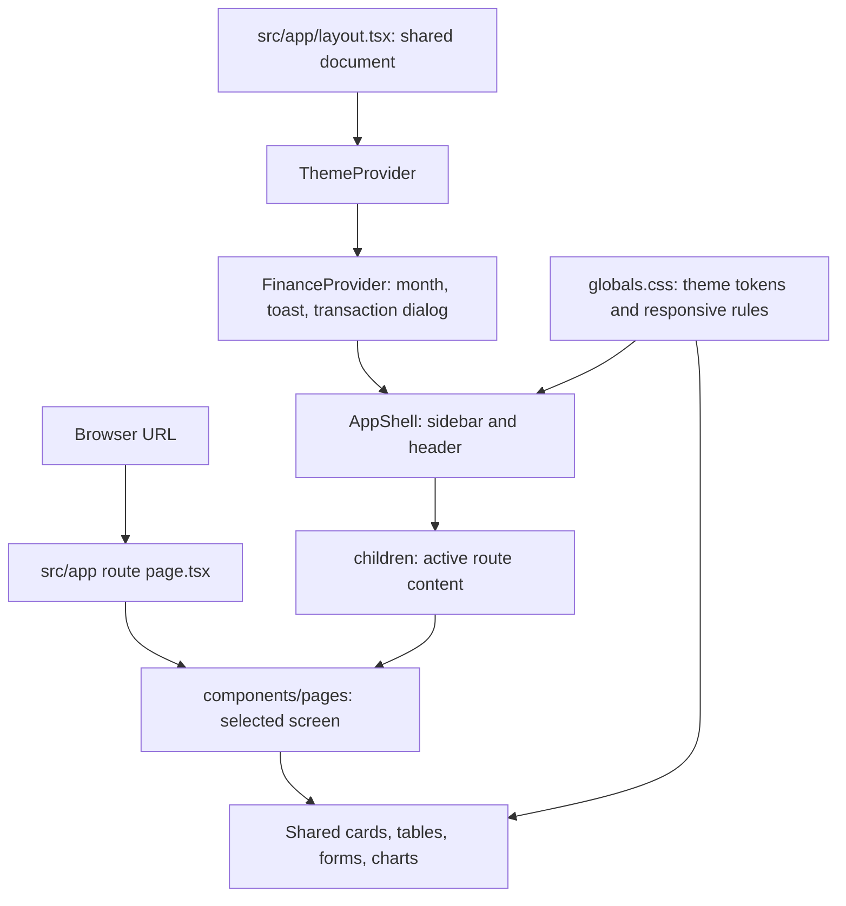
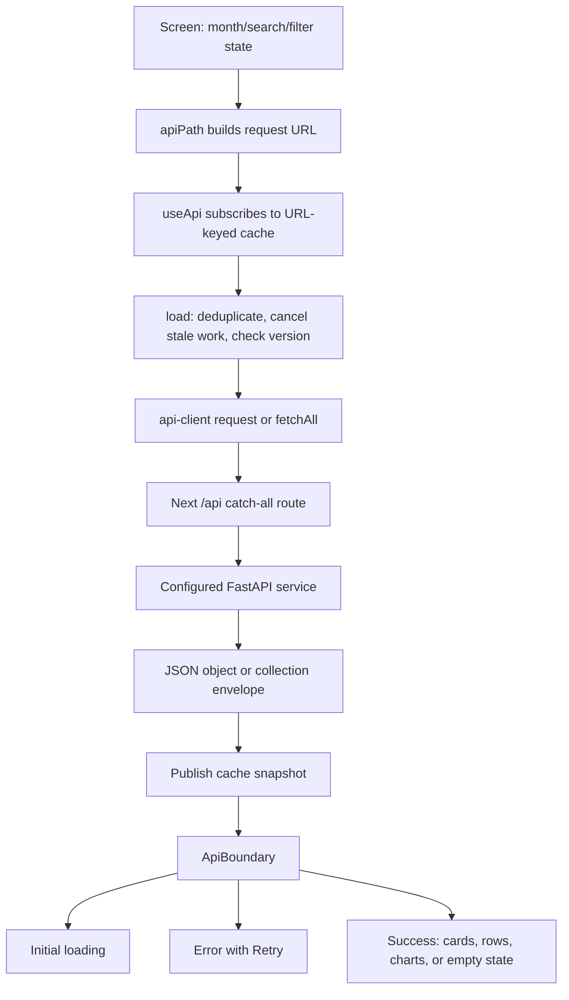
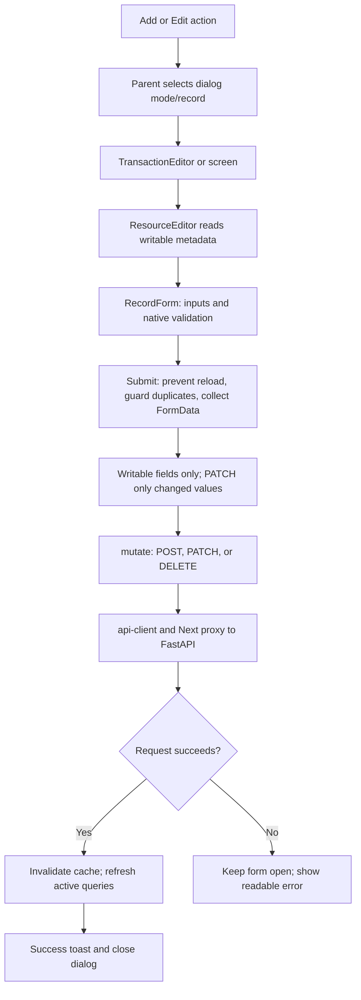

# FinTrack: project memory and flow map

Last reviewed: **21 November 2026 (Asia/Calcutta)**.

This is the starting point for a new coding session in this repository. It preserves the project decisions and working context from the original conversation. It is a handoff summary, not a copy of the chat. Check the actual files and Git diff before acting: this document records a point in time and does not prove that a service or process is still running.

## Start here in a new session

1. Read this file, then [README.md](../README.md) for commands/configuration.
2. Read [READING_CODE.md](READING_CODE.md) for the beginner walkthrough and glossary.
3. For API work, read [FRONTEND_HANDOFF.md](../FRONTEND_HANDOFF.md) and the exact schemas in [openapi.json](../openapi.json).
4. Read root [AGENTS.md](../AGENTS.md). Consult the relevant installed Next documentation before framework changes; this version differs from older Next releases.
5. Inspect `git status --short` and the relevant code. Preserve changes already made by the user. Ask what the next task is if the user has only requested context recovery; do not infer another implementation phase.

**Current position:** the complete ten-screen frontend is built, has light/dark/system themes, and is connected to the deployed FastAPI backend. A beginner explanation pass and reading guide are complete. The theme dropdown replacement is complete: the header and Settings now use a compact icon pill with Light, Dark, and System toggle buttons. No implementation work remains from this request.

## What happened, in order

1. Started with an empty repository and created a Next.js, TypeScript, Tailwind App Router app.
2. Set up access to Google Stitch and reviewed the FinTrack designs. The original design reference is Stitch project `6860123006609882530` (Finance App Design Review). Local reference downloads/screenshots are under ignored `.local/`; those files may not exist on another machine. Stitch access is an editor/tool integration, not an application runtime dependency. Recheck tool availability in a new session. No credential values belong in this document or application source.
3. Implemented all designed modules, shared navigation/header, reusable UI, responsive layouts, charts, interactions, local calculators where designed, and exports. This first stage used mock financial data.
4. Added light, dark, and system modes, with a device preference and synchronization across tabs/OS appearance changes.
5. User supplied the backend contract files and authorized API integration. Replaced runtime mock financial data with real requests, write operations, shared caching, and loading/empty/error/retry states. The earlier request to defer backend integration was superseded by this explicit API integration task.
6. Verified all routes and live API reads; exercised live create/edit/delete with uniquely named disposable records, then deleted those records. Added contract-shaped isolated browser fixtures/tests.
7. User found it hard to follow the code and requested a strictly explanatory pass. Added beginner comments across 57 maintained source/config/test/style files and created `docs/READING_CODE.md`. Compared syntax trees, emitted JavaScript, and CSS rules against a pre-pass snapshot: behavior was unchanged. JSON/generated files were left unchanged.
8. Created this handoff and linked it from the root agent instructions and README so future sessions can recover context from repository files.

At the start of this handoff task, Git was clean and the latest commit was `2430dcc` (`comments for roadmap`); the preceding API integration commit was `7100e9a`. These identify historical milestones, not a requirement to reset to those commits. This documentation task does not commit, push, or deploy changes.

## Technology and environment

- Repository: `D:\code\finance\finance-track-nxt`; Windows PowerShell during the original work.
- Installed project versions recorded here: Next.js `16.4.6`, React/React DOM `19.3.0`, TypeScript `^5`, Tailwind `4.3.3`. Read `package.json`/lockfile for the current versions.
- Existing libraries: Recharts for charts, Lucide for icons, jsPDF for PDF, fflate for ZIP, Playwright for tests. Reuse these unless a real requirement needs something else.
- Next settings retain `cacheComponents`, `partialPrefetching`, and the existing Tailwind Turbopack loader. The API/comment passes preserved their values.
- Next documentation is installed under `node_modules/next/dist/docs/`. Route-handler `params` is asynchronous in this version.
- No authentication, database connection, or new financial backend business logic was implemented in this frontend. The Next `/api` route is a transport proxy to the existing FastAPI service.
- No frontend publication/deployment was performed as part of these tasks. The backend was already deployed by the user.

## Application composition



Route/layout wrappers are Server Components by default. Interactive screen/provider modules retain `"use client"` for hooks, event handlers, subscriptions, and browser APIs. Client Components may still have server-prerendered initial HTML; hydration attaches browser behavior. `/` renders the same Dashboard as `/dashboard` without redirecting the URL.

## Backend read flow



- Browser requests use same-origin `/api/...`. `src/app/api/[...path]/route.ts` forwards supported resources to FastAPI, preserves query parameters/statuses, and sends no browser credentials/cookies.
- Base URL precedence: server-only `API_BASE_URL`, then `NEXT_PUBLIC_API_BASE_URL`, then `https://finance-track-py.vercel.app`.
- Deployed Swagger: `https://finance-track-py.vercel.app/docs`; local Swagger supplied by user: `http://127.0.0.1:8000/docs`. Their availability must be checked when needed.
- Use `API_BASE_URL=http://127.0.0.1:8000` in local environment configuration to switch the proxy to the local backend. Restart Next after changing environment variables. On a hosted frontend, localhost refers to its own server environment.
- Financial paths start with `/api`, not `/api/v1`. The readiness check is separately `/api/v1/health/ready`.
- Ordinary collections return `{items,total,page,page_size}`; detail endpoints return one object. PPF contributions return an array. `fetchAll` traverses collection pages.
- `all:/api/...` is an internal cache key convention, stripped before HTTP. Never send `all:` to FastAPI.
- Request cache uses `useSyncExternalStore`, deduplication, abort signals, and request versions. It lives in memory. HTTP reads use `no-store`.
- Failure never falls back to fabricated runtime mock records. Test fixtures stay in tests.

## Create/edit/delete flow



- `src/components/resource-editor.tsx` adapts generated schema metadata into `FormField` definitions; `RecordForm` in `ui/primitives.tsx` renders them and awaits `onSave`.
- Many editors use **undefined = closed, null = create, record = edit**. Preserve that distinction.
- FormData values start as strings. Integer IDs/counts become numbers; decimal values remain strings. Empty nullable fields become null; omission in PATCH means keep the original value.
- Never send IDs, user IDs, timestamps, or computed read-response values. Never spread an entire response record into a write body.
- DELETE returns **204 without JSON**. Both proxy and client special-case it before parsing.
- Successful writes invalidate all cached read keys because one transaction may affect dashboard, reports, ledger, and budgets. Active queries reload immediately; inactive ones load when reused.
- Failure remains visible and retains inputs. Ref guards block rapid double submits, and pending state disables controls/closing during a save.
- Transactions keep edit/delete selection outside the loading boundary so a debounced search refresh cannot close an active form.

## Routes and implemented scope

- **`/` and `/dashboard`** → `pages/dashboard.tsx`: `/api/dashboard` supplies authoritative cards, budget usage, obligations, and recent transactions; monthly reports supply cash-flow points.
- **`/income-expenses`** → `pages/transactions.tsx`: server search/type/category/payment/date filters, server pagination, CRUD, category lookup, CSV import. Column sorting applies only to the current server page because the contract has no ordering parameter. Deleting the last row on a later page returns to an existing page.
- **`/budgets`** → `pages/budgets.tsx`: monthly envelopes, returned spending/remaining/usage, category lookup, CRUD, alert filtering.
- **`/loans-emi`** → `pages/loans.tsx`: loan CRUD, backend projected amortization, stored versus calculated EMI, separate local EMI/prepayment estimators.
- **`/stocks-investments`** → `pages/investments.tsx`: holding CRUD, returned valuations/gains, local holding search/filter, allocation, export. Partial redemption PATCHes quantity; full redemption DELETEs the holding; neither automatically creates a ledger transaction.
- **`/fixed-deposits`** → `pages/deposits.tsx`: CRUD, returned current/maturity estimates and calculation basis, maturity filtering, designed local FD estimator.
- **`/ppf-savings`** → `pages/savings.tsx`: PPF account/contribution CRUD, API interest estimate with basis, April-March contribution-year filtering, receipts, savings-goal CRUD. Contribution endpoints update balances; never increment them a second time in the frontend.
- **`/reports-analytics`** → `pages/reports.tsx`: summary/monthly/category report endpoints, comparisons, transaction-derived heatmap, current asset export, PDF/CSV/ZIP/Excel-compatible XML. Category selection affects the pie/heatmap locally, not every summary query.
- **`/calendar`** → `pages/calendar.tsx`: dashboard obligations plus saved reminders, deduplication of reminder sources, month/week/agenda, reminder CRUD/status PATCH, PDF/iCalendar export.
- **`/settings`** → `pages/settings.tsx`: flat profile/preferences PATCH, number formatting, personal-category CRUD with shared-category protection, appearance, read-only JSON export.

All screen implementations above are inside `src/components/`. Their App Router wrappers live in `src/app/<route>/page.tsx`. Common primitives, table, icons, range controls, and API boundary live in `src/components/ui/`.

## Decisions that must not be lost

### Financial meaning

- Start transaction/demo testing with **October 2024**, not today's month. Demo reminders include November; an empty October reminder list is not automatically a defect. Some UI date defaults deliberately reference that demo period.
- Dashboard `balance` is **monthly net cash flow**, not an actual bank-account balance. Operating expenses exclude investment and loan-payment outflows.
- Money, rates, quantities, and computed percentages use decimal strings from the API. `api-format.total` performs exact scaled-BigInt addition for rollups; Number conversions are for presentation, comparisons, charts, and local estimators.
- Asset/loan values are current snapshots. Do not label them as historical performance. Amortization is a projection, not proof of installments actually paid.
- Settings currency selection does not convert historical INR records; no exchange-rate API exists here.
- Calendar obligations are schedules, not extra ledger transactions. Calendar sync exports an `.ics` file for manual import; it does not connect to Google or establish a bank mandate.
- CSV import submits individually and reports how many rows saved before a failure. Retrying the same entire file can duplicate those saved rows; the UI tells the user to remove them first.

### Appearance and learning preferences

- Keep the Google Stitch design fidelity, existing typography/layouts, sidebar scope, responsive behavior, and light/dark/system modes. Do not redesign or invent pages/features without a new request.
- Device appearance persists in localStorage and synchronizes across tabs/OS changes. Financial records do not persist there. `themeScript` sets initial appearance early; ThemeProvider maintains it afterward.
- The user is learning Next.js/React and wants simple **what and why** comments near relevant code, including non-obvious syntax, state, effects, API flow, and forms. Keep explanations accurate when changing code.
- Preserve `"use client"` boundaries unless a task intentionally changes them. Use syntactically valid comments in JSX/JavaScript. JSON and generated files receive explanation in the guide instead of inline edits.
- The prior explanation pass was comment/documentation/formatting only. This records its scope; future explicitly requested features are allowed and are not restricted to comments.
- The user prefers direct execution of authorized work and dislikes repeated confirmations. Ask for genuinely missing requirements rather than stopping routine progress.

### Contract gaps, not unfinished fake features

The supplied API does not expose historical market prices, sector/benchmark beta, tax calculations, AI insights, comparative bank rates, bank linking, maturity instructions, saved prepayment strategies, notification delivery/preferences, avatar/PAN/phone storage, budget rollover, or bulk restore/reset. Related designed controls are disabled or explain the limitation. This is intentional. No fake success messages or invented analytics should replace missing services.

There is per-row transaction CSV import, but no general bulk restore endpoint. Generated financial exports are personal summaries, not official bank/tax documents. The legacy ZIP download filename may still mention annual tax; its actual report content is a financial summary.

## Contracts, generated files, and security boundary

- `FRONTEND_HANDOFF.md`: endpoint mapping and financial semantics.
- `openapi.json`: exact supplied methods, writable/request schemas, response shapes, required/nullable fields.
- `scripts/generate-api-types.mjs`: maintained generator, invoked with `npm run api:types` after an intentional contract update.
- `src/types/api.ts` and `src/lib/api-contract.ts`: generated output; do not manually annotate or change them independently of the source contract.
- `.env.example`: safe URL configuration example. Do not put database credentials, tokens, or Stitch keys into docs, frontend bundles, fixtures, or repository source. The app does not require Stitch credentials to run.
- `.local/`: ignored original design references, screenshots, temporary scripts, comment-pass baselines, and test artifacts. Useful locally, but never the sole durable project specification. Some old scripts mutate real API data; read before running and do not rerun them as a routine context-recovery step.

## Verification history and commands

**Historical result from the completed implementation/explanation sessions:** lint passed, TypeScript passed, production build passed, all **22 Playwright tests** passed, and read-only live API smoke checks passed. Live create/edit/delete checks also succeeded across the nine resource modules and PPF contributions; all disposable records created during those checks were deleted with 204 responses. Original account records were not intentionally edited in that exercise.

The explanation pass also compared maintained source syntax trees and emitted JavaScript, verified unchanged CSS rules, and checked that JSON, generated files, dependency manifests, and the environment example stayed unchanged. Diff whitespace checks passed.

These are past results, **not a claim that checks have just run in a future session**. For this handoff task, only documentation and agent-entry guidance changed; the full application suite was not rerun.

```sh
npm run dev
```

Default development URL: `http://localhost:3000`. Install dependencies with `npm install` if they are absent; use the lockfile/install workflow appropriate to the next task rather than upgrading packages incidentally.

For implementation changes, select relevant checks:

```sh
npm run lint
npm run typecheck
npm run build
npm run test:e2e
npm run test:api-live
```

- Build before the browser suite: Playwright starts `npm run start` on `127.0.0.1:3100` with one worker. On Windows it defaults to installed Edge; `PLAYWRIGHT_CHANNEL` can override it. Other environments may need Chromium installed.
- Browser tests use `tests/api-fixture.ts` and `tests/fixtures/api.json`, intercepting API requests in isolation. They do not mutate the deployed account. Tests cover utility precision/CSV/errors, routes/mobile layouts, writes/changed-only PATCH/204, filters/pagination, retry, PPF balances, settings/shared categories, and themes.
- `scripts/smoke-api.mjs` is the read-only live check; it needs backend/network availability. Do not turn read-only verification into live CRUD without task authorization.
- On this machine production builds were successfully run with PowerShell `$env:CIRCLE_NODE_TOTAL='2'` before `npm run build` to limit worker use. This was a process environment setting, not a deployment configuration change.

## Theme control update ? 21 November 2026

- Replaced the shared native theme dropdown with sun/moon/monitor toggle buttons in the header and Settings. The selected mode has a raised, purple-accented circular background; tooltips and accessible names identify each icon.
- Preserved the existing theme provider, startup script, device persistence, cross-tab synchronization, and OS-following System mode. Native buttons support keyboard activation and expose selection through aria-pressed. Reduced-motion preferences disable the control transitions.
- Updated existing theme browser tests for button interactions, including Settings synchronization, keyboard activation, and returning to System mode.
- Fresh checks passed: npm run lint, npm run typecheck, npm run build, npx playwright test tests/theme.spec.ts (3/3), and git diff --check. Visually reviewed desktop dark Settings and 390px mobile light screenshots under ignored .local/. The full unrelated browser suite and live API smoke were not rerun for this UI-only change. No deployment performed.
- Preserved the pre-existing AGENTS.md/README.md changes and this previously untracked handoff.

## Keeping this memory useful

After a meaningful completed task, update the current-position paragraph, decisions/limitations if changed, and the verification history with the actual date and checks performed. Keep historical failures or abandoned approaches only when they explain a decision that still matters. Never copy secrets or claim services/tests are working without checking them.

The next user request decides the next action. There is no pending requirement to add authentication, recreate the UI, reconnect Stitch, rebuild the boilerplate, or deploy the frontend.

Copy this into a new chat if needed:

> Open this existing FinTrack repository. Read `AGENTS.md`, `docs/PROJECT_HANDOFF.md`, and `docs/READING_CODE.md` first, then inspect Git status and the relevant source files. The UI, themes, API integration, and beginner comments are already implemented. Use the handoff to recover context, preserve the existing work, and wait for my next task if I have not given one.
